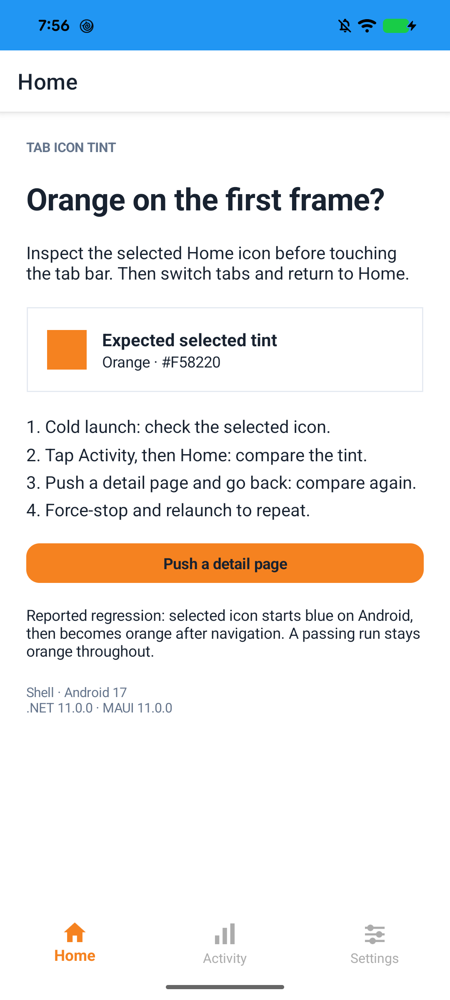
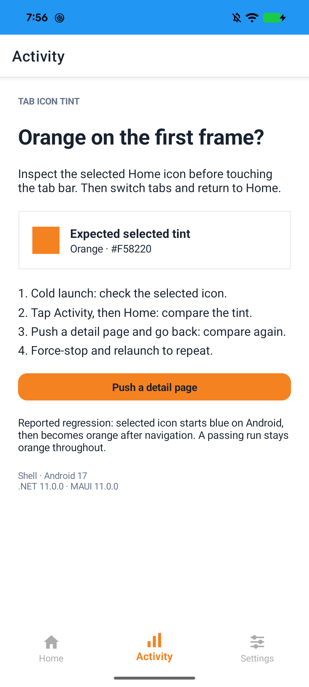
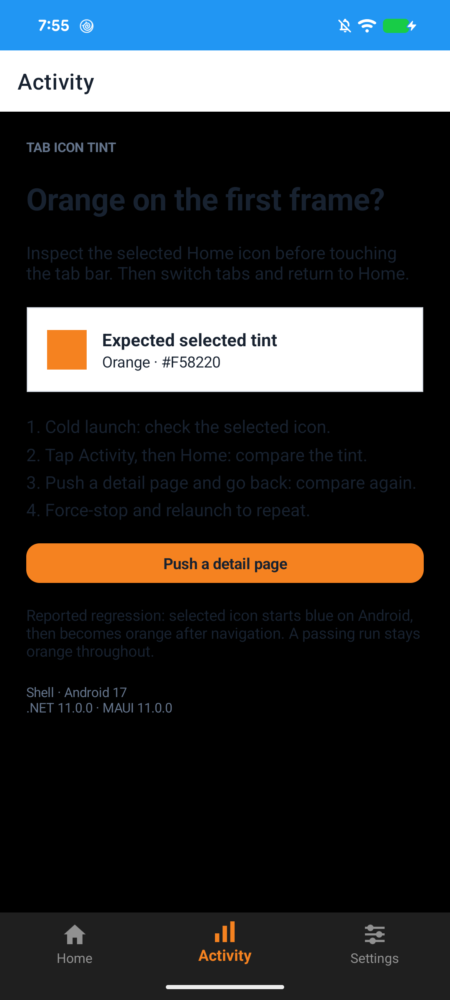

# Android Shell tab icon color regression

A .NET MAUI sample investigating an Android regression reported when moving from MAUI 10 to 11: the selected bottom-tab icon initially uses a native theme color instead of the configured orange. After navigation, the icon becomes orange. Windows reportedly behaves correctly.

The current sample uses **Shell**, **.NET 11**, and **MAUI Controls 11.0.0**. It restores the standard Android template colors and deliberately delays the Home icon load to exercise a suspected initialization race. During testing on a Pixel 8a running Android 17, the user reported that this setup reproduced the issue. Some earlier runs remained orange, so reproduction may depend on timing or theme.

## Build and run

Requires the .NET 11.0.100 SDK (or a newer 11.0 patch), the MAUI workload, Android SDK/JDK, and an Android device or emulator. `global.json` pins the SDK. Open `TabBarColorRepro.csproj` in a MAUI IDE or run:

```sh
dotnet build -t:Run -f net11.0-android
```

For a standalone APK and explicit device selection:

```sh
dotnet build -f net11.0-android
adb devices
adb -s YOUR_DEVICE_SERIAL install -r bin/Debug/net11.0-android/com.example.tabbarcolorrepro-Signed.apk
adb -s YOUR_DEVICE_SERIAL shell am force-stop com.example.tabbarcolorrepro
adb -s YOUR_DEVICE_SERIAL shell monkey -p com.example.tabbarcolorrepro -c android.intent.category.LAUNCHER 1
```

Assemblies are embedded, so the APK runs without IDE fast deployment.

## Reproduce

1. Cold-launch the app using force-stop and relaunch, rather than resuming it.
2. Leave Home selected. Wait at least two seconds for its delayed icon to appear.
3. Compare the selected **Home icon** with the orange reference square (`#F58220`). The bottom icon is the subject of the test; the system status bar is separate.
4. Switch to Activity, then return to Home. Compare the icon tint again.
5. Optionally push a detail page and go back to test another navigation path.
6. Repeat in light and dark mode, recording which theme was active.

**Expected:** the selected icon is orange as soon as it appears and stays orange.

**Reported failure:** the initial selected icon uses the native theme color, then becomes orange after navigation. With this sample's default Android resources, the fallback can be purple rather than the blue reported in the original app.

The page displays the host, platform, runtime, MAUI assembly version, and configured delay. The diagnostic page uses fixed dark text, which has poor contrast in dark mode; the tab bar itself uses the theme bindings below.

## Current color configuration

All five appearance properties are applied directly to `<TabBar>` in `AppShell.xaml`, matching the configuration supplied with the report:

```xml
<TabBar
    Shell.TabBarBackgroundColor="{AppThemeBinding Light={StaticResource White}, Dark={StaticResource OffBlack}}"
    Shell.TabBarTitleColor="{AppThemeBinding Light={StaticResource Primary}, Dark={StaticResource PrimaryDark}}"
    Shell.TabBarUnselectedColor="{AppThemeBinding Light={StaticResource Gray400}, Dark={StaticResource Gray500}}"
    Shell.TabBarForegroundColor="{AppThemeBinding Light={StaticResource Primary}, Dark={StaticResource PrimaryDark}}"
    Shell.TabBarDisabledColor="{StaticResource Gray300}">
```

The app follows the device theme. The supplied screenshot did not include resource definitions; the sample defines these in `App.xaml`:

| Resource | Value |
| --- | --- |
| Primary / PrimaryDark | `#F58220` (orange in both themes) |
| White | `#FFFFFF` |
| OffBlack | `#1F1F1F` |
| Gray300 | `#D1D1D1` |
| Gray400 | `#ACACAC` |
| Gray500 | `#919191` |

`Platforms/Android/Resources/values/colors.xml` contains the standard MAUI template values:

```xml
<resources>
    <color name="colorPrimary">#512BD4</color>
    <color name="colorPrimaryDark">#2B0B98</color>
    <color name="colorAccent">#2B0B98</color>
</resources>
```

These intentionally differ from Shell's orange so a native fallback remains visible.

## Controlled icon-loading experiment

`DelayedTabIconSource` implements `IFileImageSource` and has its own Android image service registration. `DelayedTabIconService` delegates to MAUI's normal file loader, but waits **1800 ms** before loading Home. Activity and Settings load normally. The dedicated source ensures the experiment uses this service rather than the default file service.

The experiment changes loading timing only. It does not assign native tint properties, automatically navigate, or reapply Shell colors. An artificial delay exposing the symptom does not establish that the reporter's app has the same root cause.

```sh
# Default: delay Home by 1800 ms
dotnet build -t:Run -f net11.0-android

# Control: use the same source/service without delaying Home
dotnet build -t:Run -f net11.0-android -p:IconLoadDelayMs=0

# Try a different delay
dotnet build -t:Run -f net11.0-android -p:IconLoadDelayMs=3000

# Observe icon-loading order
adb -s YOUR_DEVICE_SERIAL logcat -s TabTintRepro:I
```

Device logs confirmed that Activity and Settings completed before Home, with Home completing approximately 1.8 seconds later. The delayed sample and restored default Android colors were built and installed successfully before the user reported reproduction. A captured before/after pair for the failing run is still pending.

## Suspected cause and reported workarounds

MAUI 11 changed Android Shell from legacy renderers to a handler architecture using a shared `TabbedViewManager`; see [PR #34758](https://github.com/dotnet/maui/pull/34758).

The source suggests two interacting tint paths:

- Shell's [adapter](https://github.com/dotnet/maui/blob/11.0.0/src/Controls/src/Core/Handlers/Shell/ShellTabbedViewAdapters.Android.cs) returns null tab colors because Shell's appearance tracker handles styling separately.
- The [shared tab manager](https://github.com/dotnet/maui/blob/11.0.0/src/Controls/src/Core/Platform/Android/TabbedViewManager.cs) can cache the original native icon tint and apply a per-item tint after an icon loads.
- The [Shell handler](https://github.com/dotnet/maui/blob/11.0.0/src/Controls/src/Core/Handlers/Shell/ShellItemHandler.Android.cs) triggers further appearance updates during navigation.

**Hypothesis:** a later icon-loading callback may apply an earlier native tint after Shell has applied orange. Navigation then reapplies the Shell appearance. This remains a hypothesis; the failing callback sequence has not been traced in the reporter's app.

The reporter identified two workarounds:

1. Explicitly register the legacy Android `ShellRenderer`, avoiding the new handler path:

   ```csharp
   #if ANDROID
   builder.ConfigureMauiHandlers(handlers =>
   {
       handlers.AddHandler<Shell,
           Microsoft.Maui.Controls.Handlers.Compatibility.ShellRenderer>();
   });
   #endif
   ```

2. Set Android `colorPrimary` and `colorAccent` to the desired orange (the reporter used `#C2630A`, with `colorPrimaryDark=#8B4513`). This could mask a native fallback by making it match the desired appearance.

Neither workaround is enabled in the sample. The renderer registration is the meaningful change in the first workaround; a `Compatibility` namespace by itself does not switch rendering behavior. The workarounds have not been validated against the delayed experiment here.

## Version and host comparisons

Build variants sequentially: they use the same application ID and replace each other on installation.

```sh
# MAUI 10 baseline, using the installed .NET 11 SDK/workload dependencies
dotnet build -t:Run -f net10.0-android -p:ReproFrameworkVersion=10.0

# A different MAUI 11 package version
dotnet build -t:Run -f net11.0-android -p:MauiVersion=11.0.10

# Separate TabbedPage comparison instead of Shell
dotnet build -t:Run -f net11.0-android -p:ReproHost=TabbedPage
```

The comparison `TabbedPage` host wraps each tab in a `NavigationPage` and uses fixed white/slate tab colors. Its icons use ordinary file sources, so the delayed Shell icon experiment does not apply there.

On Windows with the appropriate MAUI/Windows workload:

```powershell
dotnet build -t:Run -f net11.0-windows10.0.19041.0
```

The initial Android .NET 10 baseline and .NET 11 Shell/TabbedPage builds passed. The current delayed-icon .NET 11 Android build passed with zero warnings/errors and launched on the Pixel. The current delayed setup has not been validated on .NET 10 or Windows.

## Earlier screenshots

These screenshots predate the delay experiment and restoration of the standard Android template colors. They show earlier passing runs with blue native theme overrides; they are not screenshots of the reproduced failure.

| Light: cold launch | Light: after navigation |
| --- | --- |
|  |  |

| Dark: cold launch | Dark: after navigation |
| --- | --- |
|  |  |
