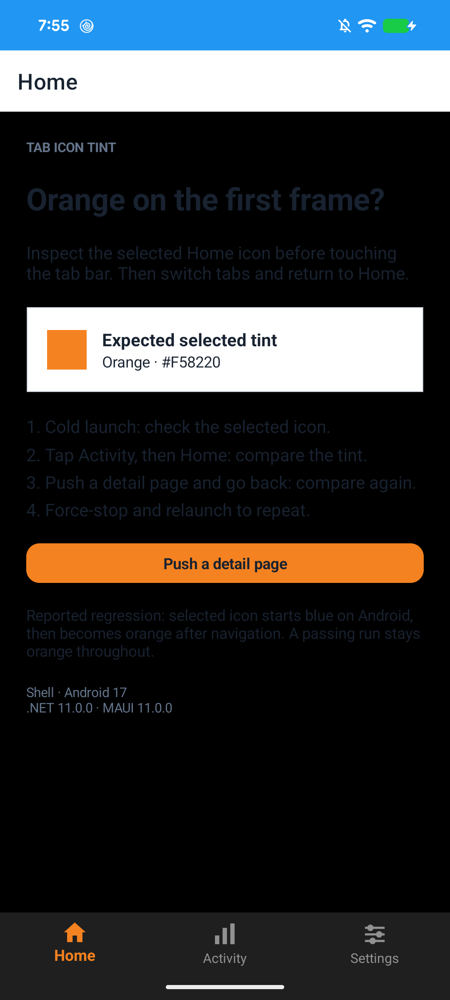

# Android tab icon color regression repro

A small .NET MAUI app for investigating the report that a selected native tab icon is blue on its first appearance in MAUI 11, but becomes the configured orange after navigation. The same source can run against MAUI 10 and on Windows as a control.

This is a diagnostic reproduction candidate: it uses normal MAUI APIs and does not force the bug or reapply colors after navigation.

## Screenshots

Captured from the current Shell build on a Pixel 8a running Android 17 with MAUI 11.0.0. The selected icon is orange on cold launch and after switching to Activity in both themes; the reported blue-to-orange regression was not observed in these runs.

| Light: cold launch | Light: after navigation |
| --- | --- |
|  |  |

| Dark: cold launch | Dark: after navigation |
| --- | --- |
|  |  |

The diagnostic page still uses fixed dark text, so its body has poor contrast in dark mode. The bottom tab bar is the subject of this comparison and uses the theme bindings shown below.

## Run

Requires .NET SDK 11.0.100 (or a newer 11.0 patch), the MAUI workload, Android SDK/JDK, and an emulator or device. `global.json` pins the SDK. Open `TabBarColorRepro.csproj` in your MAUI IDE or run:

```sh
dotnet build -t:Run -f net11.0-android
```

The default host is Shell and the default Controls package is pinned to **11.0.0**. To compare `TabbedPage` instead:

```sh
dotnet build -t:Run -f net11.0-android -p:ReproHost=TabbedPage
```

Use the same host option when comparing versions. Both hosts have three bottom tabs and black SVG source icons that are tinted by MAUI/native controls. Shell matches the supplied screenshot by setting all five colors directly on `<TabBar>`: background binds to `White` / `OffBlack`; title and foreground bind to `Primary` / `PrimaryDark`; unselected binds to `Gray400` / `Gray500`; disabled uses `Gray300`. The app follows the device theme. Since the screenshot does not show resource definitions, both primary resources use the existing orange (`#F58220`), with `White=#FFFFFF`, `OffBlack=#1F1F1F`, `Gray300=#D1D1D1`, `Gray400=#ACACAC`, and `Gray500=#919191`. The comparison `TabbedPage` host retains its fixed white background and slate unselected tint.

## Reproduction steps

1. Force-stop the app, then launch it. Before navigating, inspect the **Home icon** against the orange swatch on the page.
2. Tap **Activity**, then **Home**. Compare the selected icon again.
3. Tap **Push a detail page**, then **Go back**. Compare again.
4. Repeat with MAUI 10, keeping the device, host, theme, and steps the same.

**Expected:** the selected icon is orange from its first appearance and remains orange.

**Reported regression:** on Android with MAUI 11, the selected icon initially uses the native blue and becomes orange after navigation. WinUI reportedly remains orange throughout.

The page displays the actual MAUI assembly version, .NET runtime, platform, and host. Capture the initial state before interacting with the tabs. A warm resume does not repeat native tab initialization; force-stop for every initial-state test.

## Compare MAUI versions

The installed .NET 11 SDK can also build the .NET 10 Android target when its workload dependencies are available:

```sh
# MAUI 10 baseline
dotnet build -t:Run -f net10.0-android -p:ReproFrameworkVersion=10.0

# MAUI 11 initial release
dotnet build -t:Run -f net11.0-android

# Test a servicing release or the exact package from the affected app
dotnet build -t:Run -f net11.0-android -p:MauiVersion=11.0.10
```

Add `-p:ReproHost=TabbedPage` to any command to compare that host. All builds use the same application ID, so installing another variant replaces the previous one. Build variants sequentially.

## Build and install a standalone APK

```sh
dotnet build -f net11.0-android
adb -s YOUR_DEVICE_SERIAL install -r bin/Debug/net11.0-android/com.example.tabbarcolorrepro-Signed.apk
adb -s YOUR_DEVICE_SERIAL shell am force-stop com.example.tabbarcolorrepro
adb -s YOUR_DEVICE_SERIAL shell monkey -p com.example.tabbarcolorrepro -c android.intent.category.LAUNCHER 1
```

Assemblies are embedded, so the APK can run without IDE fast deployment. Use `adb devices` to find the device serial and explicitly select it when more than one device is attached.

## Windows control

On Windows with the MAUI/Windows workload:

```powershell
dotnet build -t:Run -f net11.0-windows10.0.19041.0
```

The `ReproFrameworkVersion`, `ReproHost`, and `MauiVersion` switches work there too; use `net10.0-windows10.0.19041.0` for the .NET 10 baseline.

## Relevant code

- `AppShell.xaml`: Shell tab definitions and color properties applied on `TabBar`, including `AppThemeBinding` for background, foreground, and title.
- `ReproTabbedPage.cs`: `TabbedPage` colors set before native control creation.
- `App.xaml`: app color resources.
- `ReproPage.cs`: comparison swatch, manual steps, detail navigation, version information.
- `Platforms/Android/Resources/values/colors.xml`: intentionally blue native theme colors, distinct from the orange MAUI tab color. This makes fallback visible; it does not change colors at runtime. Replace with the affected app's theme values if needed.

No custom handlers, delayed setters, automatic tab changes, or native tint fixes are used.

MAUI API references: [Shell tabs](https://learn.microsoft.com/dotnet/maui/fundamentals/shell/tabs), [TabbedPage](https://learn.microsoft.com/dotnet/maui/user-interface/pages/tabbedpage).

## Local verification

- .NET 11 / MAUI 11.0.0: Android Shell and TabbedPage builds pass with zero warnings/errors; standalone APK installed and launched on a connected Pixel 8a running Android 17.
- TabbedPage cold-launch screenshot shows the Home icon orange; switching to Activity also shows an orange selected icon. Shell's observed Home screen also shows orange. The reported regression has **not been reproduced** with this configuration.
- .NET 10 / MAUI 10.0.20: Android build passed with zero warnings/errors before standalone embedding was enabled; runtime comparison is still pending.
- Windows: source included; not built or run on this Mac.

The blue system status bar is from the deliberately blue Android theme. The target of the test is the selected icon in the bottom tab bar, not the system status bar.

The screenshots above verify the current setup after moving all five Shell color bindings onto `TabBar`. The selected icon remained orange on cold launch and after switching tabs in both light and dark mode.
